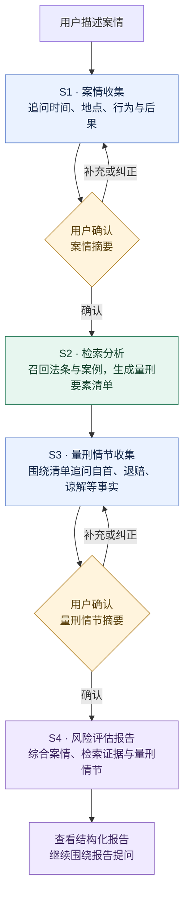
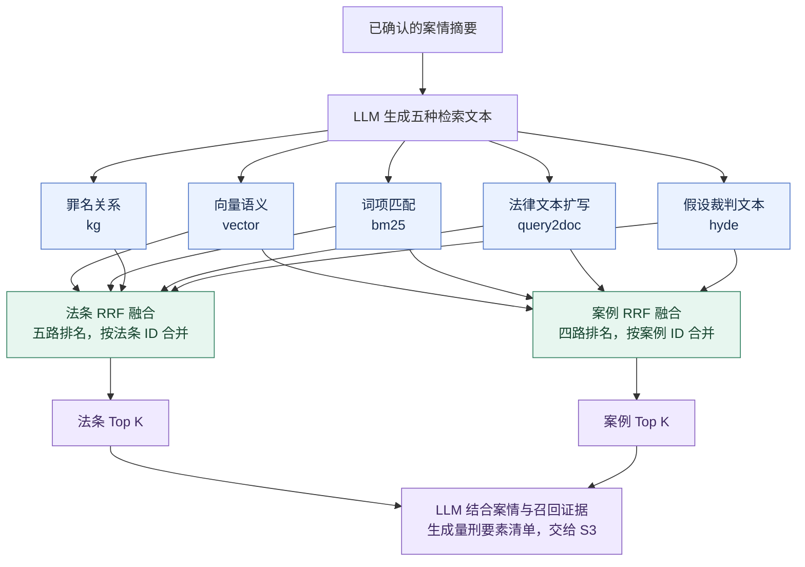

# LawGent 刑事法律服务助手

LawGent 是一个面向**刑事法律咨询**场景的智能体系统，采用前后端分离架构，基于多阶段 Agent 流程完成从"案情收集"到"风险评估报告"的完整链路。

> 项目最初作为本科毕业设计完成，现开源供学习与研究参考。输出内容不构成正式法律意见。

## 核心能力

- **四阶段咨询链路（S1 → S4）**
  - S1 案情收集：引导用户补全时间、地点、行为、后果等刑事要素
  - S2 检索分析：多路召回法条与相似案例，生成量刑要素清单
  - S3 量刑情节收集：围绕清单追问赔偿、谅解、自首、伤情等级等情节
  - S4 风险评估报告：综合前序阶段生成结构化报告，支持后续追问
- **混合检索**：向量检索（Lawformer）+ BM25 + 知识图谱增强，RRF 融合排序
- **会话与阶段持久化**：会话状态、阶段确认、消息历史均落库，支持恢复与回看
- **前端实时交互**：SSE 流式输出、阶段进度可视化

## 四阶段咨询流程

S1 和 S3 通过对话收集信息，各有一次用户确认；S2 和 S4 在确认后自动执行。



- **S2 的输入**：用户确认的 S1 案情摘要。
- **S3 的输入**：案情摘要、召回的法条与案例、量刑要素清单。
- **S4 的输入**：S1 摘要、S2 检索结果与清单、用户确认的 S3 情节。
- 消息、阶段产物和会话状态持久化到数据库；检索或报告生成失败后可重试。

## 五路混合检索

LLM 根据案情生成五种检索文本，法条与案例分别融合排序。图中的 `K` 对应请求参数 `count`，默认值为 5。



| 路径 | 检索方式 | 召回对象 |
| --- | --- | --- |
| 向量语义 | 语义查询经 Lawformer 编码，在本地向量矩阵中计算余弦相似度 | 法条、案例 |
| BM25 | 关键词经 Jieba 分词与字级 2/3-gram 处理，查询 BM25 文本索引 | 法条、案例 |
| 知识图谱 | AC 自动机识别罪名，按罪名—法条关系频次召回 | 法条 |
| Query2Doc | LLM 扩写法律条文风格文本，再经 Lawformer 编码检索 | 法条、案例 |
| HyDE | LLM 生成假设裁判文本，再经 Lawformer 编码检索 | 法条、案例 |

三路语义文本先并行编码，再并行执行九个召回子任务。每个子任务最多取 `3 × K` 个候选；RRF 按各路排名累加分数，法条、案例各保留 `K` 条。默认最终最多返回 **5 条法条 + 5 个案例**，同时保留各路结果供查看。

Query2Doc 和 HyDE 的生成文本用于构造查询；报告引用的证据来自召回的原始法条与案例。当前在线向量检索使用本地 NumPy 矩阵，会话与阶段数据由 PostgreSQL 保存。

## 技术栈

| 层 | 技术 |
| --- | --- |
| 后端 | FastAPI、SQLModel / SQLAlchemy / Alembic、PostgreSQL（pgvector）、LangChain、Transformers（Lawformer） |
| 前端 | Vue 3、TypeScript、Vite、Pinia、Tailwind |
| 基础设施 | PostgreSQL（Docker）、本地向量/图谱数据、本地模型权重 |

## 仓库结构

```text
LawGent/
├─ backend/                    # FastAPI 后端
│  ├─ app/
│  │  ├─ api/                  # 路由层
│  │  ├─ agent/                # S1-S4 业务逻辑与提示词
│  │  ├─ services/             # 检索、会话等服务
│  │  ├─ models/               # 数据模型
│  │  └─ core/                 # 配置、日志、依赖
│  ├─ alembic/                 # 数据库迁移
│  ├─ tests/                   # 后端测试
│  ├─ pyproject.toml
│  └─ main.py                  # 启动入口
├─ frontend/                   # Vue 前端
│  └─ src/
├─ research/                   # 数据流水线与模型微调示例
│  ├─ cloud_training_suite/    # 数据流水线、模型微调与评估示例
│  └─ lawgent-db/              # 本地 PostgreSQL 容器编排
├─ models/                     # 模型目录（权重需自行下载，见下）
└─ README.md
```

## 环境要求

- Python `>= 3.11`（模型枚举使用 Python 3.11 的 `StrEnum`）
- Node.js 22.x、npm 10.x
- `uv`（Python 依赖管理）
- Docker / Docker Compose（本地 PostgreSQL）

## 快速开始

### 1. 启动数据库（PostgreSQL + pgvector）

```bash
cd research/lawgent-db
docker compose up -d
```

默认连接（与 `backend/.env.example` 一致）：host `localhost`、port `54321`、db `lawgent`、user `LawGent`、password `LawGent`。

### 2. 启动后端

```bash
cd backend
uv venv
uv sync
cp .env.example .env        # 按需修改配置
uv run alembic upgrade head
uv run python main.py
```

- API: `http://127.0.0.1:5006`
- Docs: `http://127.0.0.1:5006/docs`

升级已有数据库前应备份。历史迁移 `f4a2b3c1d5e6` 曾包含清空用户和咨询数据的逻辑，现已移除；已经执行旧版迁移而被删除的数据只能从原备份恢复。旧报告会转存到阶段记录；标识迁移会保留旧标题，为空标题或重复标题生成独立会话标识。

### 3. 启动前端

```bash
cd frontend
npm ci
npm run dev
```

- Web: `http://localhost:5173`（默认代理到 `http://localhost:5006`）

## 数据与模型准备

本仓库只包含代码，较大的数据与模型权重需自行准备。完整的依赖清单、来源与放置位置见
[DEPENDENCIES.md](./DEPENDENCIES.md)。下面是要点。


**1. 检索数据**：数据来自下面两个公开数据集，需自行获取后按流水线处理，再放入 `data/`：

- **刑事案例：CAIL2018** —— [github.com/thunlp/CAIL](https://github.com/thunlp/CAIL)
  大规模中文法律判决预测数据集，含案件事实、罪名标注与适用法条。用于构建案例检索库与知识图谱。
- **刑法条文：LawRefBook/Laws** —— [github.com/LawRefBook/Laws](https://github.com/LawRefBook/Laws)
  开源法律文本库，提供结构化的刑法条文。

处理后可得到 `data/processed/` 下的向量、案例与知识图谱文件，目录需与 `backend/.env` 中的
`DATA_VECTORS_PATH`、`DATA_CRIMINAL_PATH`、`DATA_KG_PATH` 对应。
处理流程见 `research/cloud_training_suite/data_pipeline/`。使用时请遵守各数据集自身的许可与条款。

**2. Lawformer 基础模型**：从 [thunlp/Lawformer](https://huggingface.co/thunlp/Lawformer) 下载，
放入 `models/lawformer/`，并在 `.env` 中设置 `LOCAL_MODEL_PATH`。

**3. 微调权重**：将对比学习微调得到的 `lawformer_backbone_only.pt` 放入 `models/`，
并设置 `FINETUNED_MODEL_PATH`。

**4. LLM**：默认使用 DeepSeek（OpenAI 兼容接口）。在 `.env` 中填写 `LLM_API_KEY`，
或改用其他兼容服务并调整 `LLM_API_BASE` / `LLM_MODEL`。

## 关键配置

`backend/.env` 中通常需要检查：

`DATABASE_URL`、`DATA_VECTORS_PATH`、`DATA_CRIMINAL_PATH`、`DATA_KG_PATH`、
`LOCAL_MODEL_PATH`、`FINETUNED_MODEL_PATH`、`MODEL_OFFLINE_MODE`、`HF_HOME`、`LLM_API_KEY`。

公开部署时设置 `DEBUG=False`，使用随机 `JWT_SECRET`，并将 `CORS_ORIGINS` 改为实际前端地址。`.env.example` 的调试配置和示例密钥仅供本地开发。

AI 输入和回复正文默认不写入日志。只有在受控调试时才将 `LOG_AI_CONTENT=True`；开启后，日志可能包含个人案件信息，应限制访问并及时清理。

访问日志中的认证参数与检索正文会脱敏；第三方 HTTP/LLM 客户端不会输出调试请求正文，异常诊断也不展示局部变量。

S2 检索与 S4 报告任务的运行时限为 15 分钟，超时后可在界面重试。异常停机留下的处理中会话，在 30 分钟无更新后，查询状态时会转为失败并允许重试；当前不提供跨进程断点续算。

> 请勿把填好真实密钥的 `.env` 提交到仓库。

## API 概览

路由前缀：`/api/v1/agent`

| 方法 | 路径 | 说明 |
| --- | --- | --- |
| POST | `/sessions` | 创建会话 |
| GET | `/sessions/{thread_id}/state` | 查询会话状态 |
| POST | `/sessions/{thread_id}/message` | 发送消息（SSE） |
| POST | `/sessions/{thread_id}/advance` | 阶段推进 |
| POST | `/sessions/{thread_id}/confirm` | 确认卡点 |
| GET | `/sessions/{thread_id}/report` | 获取 S4 风险评估报告 |
| GET | `/conversations` | 会话列表 |
| GET | `/conversations/{thread_id}/messages` | 历史消息 |
| DELETE | `/conversations/{thread_id}` | 删除会话 |

阶段取值：`s1_collecting`、`s1_confirming`、`s2_searching`、`s2_failed`、
`s3_collecting`、`s3_confirming`、`s4_generating`、`s4_done`、`s4_failed`。

## 测试

```bash
cd backend
uv run pytest
```

## 许可证与第三方

- 本项目代码以 [MIT License](./LICENSE) 开源。
- 本项目引用的第三方数据与模型（CAIL2018 数据集、LawRefBook/Laws 法条、thunlp/Lawformer 模型）
  版权归各自作者所有，使用前请遵守其原始许可证。仓库不分发这些数据与权重，获取方式见上。
  详见 [THIRD_PARTY.md](./THIRD_PARTY.md)。

## 免责声明

本项目输出内容仅供学习、研究与辅助参考，不构成正式法律意见。实际案件请咨询执业律师并结合完整证据材料判断。


