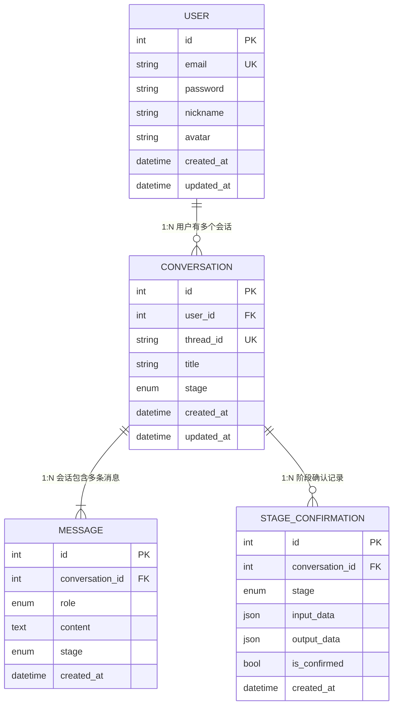

# 数据库模型说明文档

> 使用 SQLModel（SQLAlchemy + Pydantic）定义，数据库为 PostgreSQL

---

## 目录

- [BaseModel 基础模型](#basemodel-基础模型)
- [User 用户表](#user-用户表)
- [Conversation 会话表](#conversation-会话表)
- [Message 消息表](#message-消息表)
- [StageConfirmation 阶段确认表](#stageconfirmation-阶段确认表)
- [枚举类型](#枚举类型)
- [关系图](#关系图)
- [级联删除策略](#级联删除策略)

---

## BaseModel 基础模型

所有表均继承自 `BaseModel`，统一提供主键和创建时间，避免重复定义。

| 字段 | 类型 | 约束 | 说明 |
|------|------|------|------|
| id | int | PK, Auto | 主键，自增 |
| created_at | datetime | Auto, UTC | 创建时间 |

---

## User 用户表

| 字段 | 类型 | 约束 | 说明 |
|------|------|------|------|
| id | int | PK, Auto | 主键，自增 |
| email | str | Unique, Index, 255 | 用户邮箱，唯一 |
| password | str | 255 | 密码哈希（SHA-256 + Base64 后 bcrypt；登录兼容并升级旧 bcrypt） |
| nickname | str | Nullable, 100 | 用户昵称 |
| avatar | str | Nullable, 500 | 头像 URL |
| created_at | datetime | Auto, UTC | 创建时间 |
| updated_at | datetime | Nullable, onupdate | 最后更新时间 |

**关系**：`User` 1:N `Conversation`

**示例数据**：

| id | email | nickname | created_at |
|----|-------|----------|------------|
| 1 | user@example.com | 张三 | 2025-01-01 00:00:00 |

---

## Conversation 会话表

每次用户发起法律咨询即创建一条会话记录，通过 `stage` 字段跟踪 Agent 当前所处阶段。

| 字段 | 类型 | 约束 | 说明 |
|------|------|------|------|
| id | int | PK, Auto | 主键，自增 |
| user_id | int | FK -> users, Cascade | 用户ID |
| thread_id | str | Unique, Index, 255 | 会话唯一标识，与标题独立 |
| title | str | Nullable, 255 | 会话标题 |
| stage | ConversationStage | Default=s1_collecting | 当前阶段 |
| created_at | datetime | Auto, UTC | 创建时间 |
| updated_at | datetime | Nullable, onupdate | 最后更新时间 |

**关系**：
- `User` 1:N `Conversation`
- `Conversation` 1:N `Message`（cascade delete）
- `Conversation` 1:N `StageConfirmation`（cascade delete）

---

## Message 消息表

存储会话中每一轮的对话内容。

| 字段 | 类型 | 约束 | 说明 |
|------|------|------|------|
| id | int | PK, Auto | 主键，自增 |
| conversation_id | int | FK -> conversations, Cascade | 会话ID |
| role | MessageRole | - | 消息角色（user/assistant/system） |
| content | Text | Not Null | 消息正文 |
| stage | ConversationStage | Default=s1_collecting | 消息所属阶段，用于区分 S1、S3 和报告追问 |
| created_at | datetime | Auto, UTC | 创建时间 |

**设计说明**：
- 无 `updated_at`，消息创建后不可修改，保证对话记录的不可篡改性
- 当前 API 提供整段会话删除，不提供单条消息撤回。

**关系**：`Conversation` 1:N `Message`

---

## StageConfirmation 阶段确认表

记录每个阶段的输入输出，便于追溯；当前 API 不提供历史阶段回滚。

| 字段 | 类型 | 约束 | 说明 |
|------|------|------|------|
| id | int | PK, Auto | 主键，自增 |
| conversation_id | int | FK -> conversations, Cascade | 会话ID |
| stage | StageType | - | 阶段类型 |
| input_data | JSON | Not Null | 输入数据（用户确认的内容/检索结果等） |
| output_data | JSON | Not Null | 输出数据（生成的摘要/报告等） |
| is_confirmed | bool | Default=True | 是否已确认 |
| created_at | datetime | Auto, UTC | 创建时间 |

**阶段类型说明**：
- `s1_confirm`：S1 案情收集确认，输入为用户描述，输出为案情摘要
- `s2_search`：S2 法律检索，输入为 facts，输出为检索结果
- `s2_checklist`：S2 生成的量刑要素清单
- `s3_confirm`：S3 量刑情节确认，输入为用户补充，输出为量刑情节摘要
- `s4_report`：S4 风险报告，输入为 facts + search_results，输出为风险评估报告

**关系**：`Conversation` 1:N `StageConfirmation`

---

## 枚举类型

### StageType 阶段类型

| 值 | 说明 |
|----|------|
| s1_confirm | S1 案情确认 |
| s2_search | S2 检索结果 |
| s2_checklist | S2 量刑要素清单 |
| s3_confirm | S3 量刑确认 |
| s4_report | S4 风险报告 |

### ConversationStage Agent 阶段

线性四阶段流程：

| 值 | 说明 |
|----|------|
| s1_collecting | 案情收集 |
| s1_confirming | 等待案情确认 |
| s2_searching | 法律检索 |
| s2_failed | 检索失败 |
| s3_collecting | 量刑情节收集 |
| s3_confirming | 等待量刑情节确认 |
| s4_generating | 报告生成 |
| s4_done | 报告完成，可继续追问 |
| s4_failed | 报告生成失败 |

**状态流转**：`s1_collecting → s1_confirming → s2_searching → s3_collecting → s3_confirming → s4_generating → s4_done`。拒绝确认时返回对应 collecting 阶段；检索或报告异常进入对应 failed 阶段。

### MessageRole 消息角色

| 值 | 说明 |
|----|------|
| user | 用户发送的消息 |
| assistant | Agent 回复的消息 |
| system | 系统提示词（不展示给用户） |

---

## 关系图

---

## 级联删除策略

| 场景 | 策略 | 说明 |
|------|------|------|
| 删除用户 | CASCADE | 用户所有会话一并删除 |
| 删除会话 | CASCADE | 会话下所有消息、阶段确认及报告一并删除 |

---

## 字段类型对照

| Python 类型 | 数据库类型 | 说明 |
|------------|-----------|------|
| `int` | INTEGER | 整数 |
| `str` | VARCHAR | 字符串（有长度限制） |
| `str`（Text） | TEXT | 长文本（消息内容） |
| `dict`（JSON） | JSON | JSON 数据（阶段输入输出及报告） |
| `datetime` | TIMESTAMPTZ | 带时区时间戳 |
| `StrEnum` | VARCHAR | 枚举存为字符串 |
| `bool` | BOOLEAN | 布尔值 |
